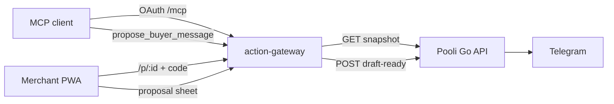

# Agent integration (MCP)

Pooli separates **payment truth** (Go API + chain worker) from **buyer-facing language** (action gateway). Agents never send messages or mark orders paid through MCP; they read snapshots and register drafts that merchants approve out of band.

Full gateway design and threat model: [`apps/action-gateway/README.md`](../apps/action-gateway/README.md).

## Architecture (agent path)



## Merchant Claude drafting (first-party)

`POST /api/v1/orders/{id}/suggest-follow-up?locale=en|fa` (merchant session) calls the **Anthropic Messages API** on a grounded order snapshot, then registers the text through the **same** action-gateway proposal path as MCP (`POST /internal/v1/proposals` on the gateway). Requires `ANTHROPIC_API_KEY`, `ACTION_GATEWAY_INTERNAL_URL`, and `AGENT_GATEWAY_SECRET` on the API.

## MCP tools (agent-visible)

| Tool | Purpose |
|------|---------|
| `get_order_snapshot` | Read canonical order + payment status + slug (read-only) |
| `propose_buyer_message` | Register a draft; returns proposal id and confirm URL |
| `check_proposal_status` | Read lifecycle state (never returns the link code) |

There is **no** tool to send DMs, confirm on behalf of the merchant, or transition payment status.

## Environment variables

### Go API (`apps/api`)

| Variable | Required | Description |
|----------|----------|-------------|
| `AGENT_GATEWAY_SECRET` | Yes (prod gateway) | Shared secret; gateway sends `X-Pooli-Gateway-Secret` |

### Action gateway (`apps/action-gateway`)

| Variable | Required | Description |
|----------|----------|-------------|
| `PUBLIC_URL` | Yes (deploy) | Base URL for OAuth discovery and `/p/:id` confirmation |
| `POOLI_API_URL` | Yes (deploy) | Internal API base, e.g. `http://pooli-api:8080` |
| `POOLI_GATEWAY_SECRET` | Yes (deploy) | Same value as `AGENT_GATEWAY_SECRET` on the API |
| `POOLI_PUBLIC_BASE_URL` | No | Merchant app links in Telegram pings (defaults to site URL) |
| `PROPOSAL_TTL_SECONDS` | No | Proposal expiry (default `600`) |
| `OAUTH_STATE_DIR` | Yes (deploy) | Persistent OAuth signing keys (`/data` volume) |

### Web PWA

| Variable | Required | Description |
|----------|----------|-------------|
| `NEXT_PUBLIC_ACTION_GATEWAY_URL` | Yes (merchant UI) | Public gateway URL; baked at **build** time |

## API routes (gateway → API)

| Method | Path | Auth |
|--------|------|------|
| GET | `/api/v1/agent/orders/{orderId}/snapshot` | `X-Pooli-Gateway-Secret` |
| POST | `/api/v1/agent/draft-ready` | `X-Pooli-Gateway-Secret` |

Merchant-scoped snapshot (optional integrations):

`GET /api/v1/agent/merchants/{merchantId}/orders/{orderId}/snapshot` with `X-Pooli-Merchant-Id` + secret.

### Draft-ready (Telegram C25)

After a new proposal is registered, the gateway calls `POST /api/v1/agent/draft-ready` with:

```json
{
  "merchant_id": "uuid",
  "order_id": "uuid",
  "order_slug": "my-order",
  "proposal_id": "uuid",
  "confirm_url": "https://agent.pooli.shop/p/{id}",
  "locale": "en"
}
```

The API sends a **Telegram** message to the connected merchant (idempotent per `proposal_id`). Nothing is sent to the buyer.

## Confirmation flow

1. Agent calls `get_order_snapshot` for an order id.
2. Agent calls `propose_buyer_message` with fields copied from that snapshot.
3. Gateway validates the draft (false-paid linter), stores the proposal, delivers the link code out-of-band, and notifies the merchant via Telegram when configured.
4. Merchant reviews in the PWA order screen (`?proposal=`) or on `{PUBLIC_URL}/p/{proposalId}` with the code.
5. Agent may poll `check_proposal_status`; it never receives the code.

## Verification

```bash
make evals
make verify-agent
```

## Production (Hostinger)

- Compose service: `pooli-action-gateway` on `127.0.0.1:8280`
- Nginx sample: [`deploy/hostinger/nginx-agent.pooli.shop.conf.proposed`](../deploy/hostinger/nginx-agent.pooli.shop.conf.proposed)
- Set `AGENT_GATEWAY_SECRET`, `ACTION_GATEWAY_PUBLIC_URL`, and `NEXT_PUBLIC_ACTION_GATEWAY_URL` in `deploy/hostinger/.env` before building **web** and **gateway** images.

See [`deploy/hostinger/README.md`](../deploy/hostinger/README.md) and [`docs/self-hosting.md`](self-hosting.md).
