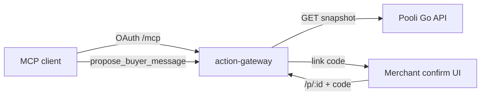

# Agent integration (MCP)

Pooli separates **payment truth** (Go API + chain worker) from **buyer-facing language** (action gateway). Agents never send messages or mark orders paid through MCP; they read snapshots and register drafts that merchants approve out of band.

Full gateway design and threat model: [`apps/action-gateway/README.md`](../apps/action-gateway/README.md).

## Architecture (agent path)



## MCP tools (agent-visible)

| Tool | Purpose |
|------|---------|
| `get_order_snapshot` | Read canonical order + payment status + slug (read-only) |
| `propose_buyer_message` | Register a draft; returns proposal id and confirm URL |
| `check_proposal_status` | Read lifecycle state (never returns the link code) |

There is **no** tool to send DMs, confirm on behalf of the merchant, or transition payment status. If a client tries to call a non-existent tool, the server responds with tool-not-found — that is intentional capability reduction.

## Environment variables (gateway)

| Variable | Required | Description |
|----------|----------|-------------|
| `PORT` | No | HTTP listen port (default `8080`) |
| `PUBLIC_URL` | Yes (deploy) | Base URL for OAuth discovery and confirmation links |
| `PROPOSAL_TTL_SECONDS` | No | Proposal expiry (default `600`) |
| `POOLI_API_URL` | No | When set, gateway fetches snapshots from the Go API instead of the local fixture |
| `POOLI_AGENT_TOKEN` | No | Bearer token for agent snapshot routes when the API requires auth |
| `OAUTH_STATE_DIR` | No | Persistent OAuth signing keys and registrations |
| `OPERATOR_TOKEN` | No | Demo-only operator inbox; unset in production |

Local e2e without the API: leave `POOLI_API_URL` unset and use order id `ord_e2e_fixture` (see gateway tests).

When `POOLI_API_URL` is set, the gateway calls:

`GET {POOLI_API_URL}/api/v1/agent/orders/{orderId}/snapshot`

## Confirmation flow

1. Agent calls `get_order_snapshot` for an order id.
2. Agent calls `propose_buyer_message` with `body`, `locale`, `paymentStatus`, and `orderSlug` copied from that snapshot.
3. Gateway validates the draft (including a **false-paid linter**), stores a proposal, and delivers a **link code** on a channel the agent cannot read (SMS, Telegram to merchant, demo outbox, etc.).
4. Merchant opens `{PUBLIC_URL}/p/{proposalId}`, reviews the **server-stored** draft (not agent paraphrase), and submits the link code.
5. Agent may poll `check_proposal_status` but never receives the code or executes delivery.

Payment status in the draft is frozen at propose time and checked against the snapshot; mismatches are refused.

## Orchestrator guidance

- Always snapshot before propose for the same order id.
- Do not ask the user for the link code in chat; it is out-of-band by design.
- Treat tool descriptions as normative: proposing does not send anything.

## Verification

From repo root:

```bash
make evals          # deterministic agent-safety cases (30+)
make verify-agent   # evals + gateway unit tests + sticky e2e
```

Case definitions: [`evals/dataset/cases.yaml`](../evals/dataset/cases.yaml). Analysis notes: [`evals/analysis/README.md`](../evals/analysis/README.md).

## Docker Compose

Use the `agent` profile when running the full stack with the gateway (see [`docs/local-development.md`](local-development.md) if documented) or start the gateway from `apps/action-gateway` after `npm run build`.
