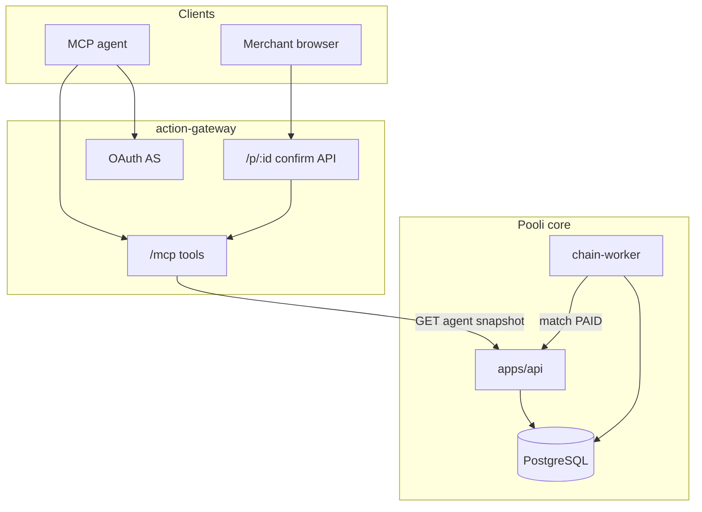

# Pooli Architecture

Pooli is a non-custodial USDT payment/order product for social-commerce sellers.

## Shape

- `apps/web` — Next.js PWA (merchant dashboard + public checkout `/p/{slug}` + admin)
- `apps/api` — Go HTTP API (chi)
- `apps/chain-worker` — Go background worker (observe → verify → match → notify)
- Shared Go packages under `internal/`
- PostgreSQL is the source of truth
- Realtime uses in-process SSE hubs (not Redis). `REDIS_URL` remains in env/compose for possible future jobs but is unused by the Go services today
- Production deploy: Docker Compose (`deploy/hostinger/`) behind nginx TLS for web + API hosts

## Money model

- Seller amounts are **TMN (toman)** integers.
- USDT is tracked in **base units** (6 decimals) as `int64` across the product.
- BNB Smart Chain Binance-Peg USDT is **18 decimals on-chain**; the EVM adapter scales to/from Pooli’s 6-decimal units at the observation / payment-URI boundary (see ADR-006).
- Rates are `NUMERIC` with source + timestamps; never float for matching.

## Payment matching

Buyer pays USDT directly to the merchant wallet. Pooli maps transfers to payment options via **unique payable amount** per `(destination, network, token, active reservation)`.

## Chain adapters

`ChainAdapter` normalizes TRON and EVM transfers into a common `ChainEvent`. Only server-side verification can transition an intent to `PAID`.

## Realtime

SSE streams `payment.*` events to checkout and merchant dashboards. Clients always refetch canonical REST state on reconnect.

## Ops status

- `GET /healthz` — liveness
- `GET /api/v1/ops/status` — non-secret config enums + chain-worker heartbeat + watcher cursor ages (HTTP 503 in production when rates are mock, simulator is on, or worker heartbeat is stale)

## Agent action gateway

Agents integrate through `apps/action-gateway` (Node MCP + HTTP confirmation). The Go API remains the source of payment truth; the gateway may read agent snapshots from the API when `POOLI_API_URL` is configured.

MCP exposes only snapshot read, message propose, and proposal status. Confirmation and delivery paths are separate HTTP surfaces so prompt injection in the agent channel cannot approve on behalf of the merchant. See [`docs/agent-integration.md`](agent-integration.md) and [`apps/action-gateway/README.md`](../apps/action-gateway/README.md).

## Non-goals (V1)

No custody, private keys, fiat settlement, swaps, or multi-token support.
